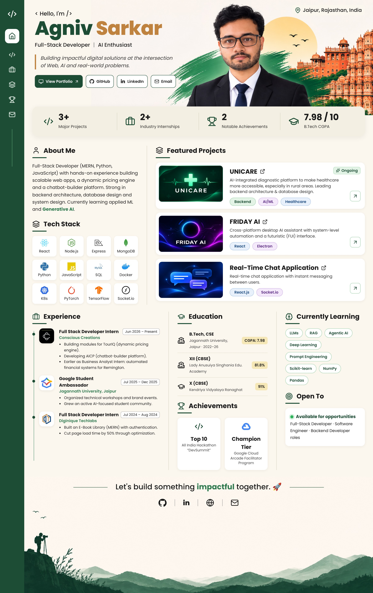

  

  
  
  

<h2 align="center">📊 GitHub Activity</h2>

  

<b>📄 Text version (for quick reading)</b>

**Agniv Sarkar** · Full-Stack Developer · Jaipur, India

- **Experience:** Full Stack Developer Intern @ Conscious Creations (TourIQ pricing engine, AICP chatbot builder) · Business Analyst Intern (Remington) · Google Student Ambassador · Full Stack Intern @ Diginique Techlabs (cut page load time by 50%)
- **Projects:** UNICARE (AI diagnostic platform) · FRIDAY AI (desktop assistant, React + Electron) · Real-Time Chat (React + Socket.io)
- **Skills:** Python, JavaScript, SQL, React, Node.js, Express, MongoDB, MySQL, Docker, Kubernetes · Learning PyTorch, TensorFlow, LLMs, RAG
- **Education:** B.Tech CSE, Jagannath University (2022–2026) · CGPA 7.98
- **Achievements:** Top 10 in DevSummit All India Hackathon · Champion Tier, Google Cloud Arcade Facilitator Program

